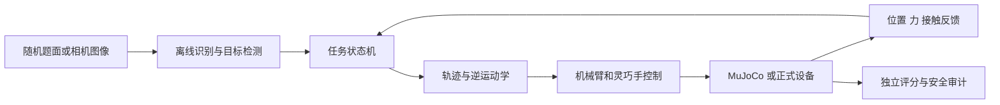

# 架构与文件地图

## 当前数据流



控制程序只能使用相机、关节和力反馈。MuJoCo 内部真实坐标只能用于生成场景、评分和诊断，不能传给参赛控制器，否则仿真成绩无法代表现场能力。

## 目录职责

| 路径 | 代表什么 | 通常何时修改 |
|---|---|---|
| `config/` | 规则、场景、控制参数和设备参数 | 调整实验参数、加入新版场景或填写正式硬件信息 |
| `fivefinger/autonomy/` | 与设备无关的自主任务核心 | 修改感知、状态机、保护逻辑和规划 |
| `fivefinger/competition_rules.py` | 加载并校验当前正式规则契约 | 规则修订或增加启动前规则检查时 |
| `fivefinger/scene.py` | MuJoCo 场景装配与对象引用 | 加入四张纸、龙图、笔架和墨池变化 |
| `fivefinger/control.py` | 关节和执行器控制 | 调整控制律、限幅和反馈 |
| `fivefinger/mujoco_kinematics.py` | MuJoCo 中的运动学计算 | 修改逆运动学目标、雅可比和坐标变换 |
| `fivefinger/trajectory.py` | 汉字笔画到书写路径 | 修改缩放、落笔、抬笔、速度和字符布局 |
| `fivefinger/vision.py` | 本地 OCR 和图像候选提取 | 修改题面文字识别和圆形候选 |
| `experiments/` | 完整流程、扰动试验和诊断工具 | 新建可重复实验，不放正式控制接口 |
| `tests/` | 快速验证和回归测试 | 每个关键规则、坐标变换和安全条件都应有对应测试 |
| `assets/` | 本地 OCR 权重、字形和题库 | 更新来源明确且允许分发的资源 |

## 关键文件

### 设备接口

`fivefinger/autonomy/devices.py` 定义机械臂、灵巧手、相机和调试检查的通用接口。拿到正式 SDK 后，应新增类似下面的文件：

```text
fivefinger/hardware/official_arm.py
fivefinger/hardware/official_hand.py
fivefinger/hardware/official_camera.py
fivefinger/hardware/official_runtime.py
```

适配器负责单位转换、关节顺序、命令超时和错误码。上层状态机不应直接调用厂商 SDK，这样相同算法才能在仿真和真机之间切换。

### 感知

- `fivefinger/autonomy/perception.py`：从 RGB-D 观测估计笔、纸、墨池等物体位姿；
- `fivefinger/vision.py`：离线 OCR 和图像候选；
- `fivefinger/autonomy/template_eye.py`：可用于初赛目标模板能力的起点；
- `fivefinger/autonomy/tool_estimator.py`：估计笔尖和工具状态。

感知输出应带置信度、时间戳和坐标系名称。置信度不足时重新观察或安全停止，不能继续使用旧坐标盲走。

### 任务规划

- `fivefinger/autonomy/supervisor.py`：完整任务阶段和切换条件；
- `fivefinger/autonomy/planning.py`：动作规划与目标生成；
- `fivefinger/trajectory.py`：汉字笔画路径；
- `fivefinger/task.py`：早期简化任务骨架，后续应逐步合并到统一状态机，不再扩展两套流程。

建议新增两个编排器：

```text
fivefinger/tasks/preliminary_dragon_eye.py
fivefinger/tasks/final_calligraphy.py
```

它们共享抓笔、保持、蘸墨、复位和安全动作，但分别实现初赛三次点睛与决赛五分钟书写。

### 控制和安全

- `fivefinger/control.py`：基础控制命令；
- `fivefinger/autonomy/grip_guard.py`：夹持保护；
- `fivefinger/robot_surface_monitor.py`：机器人与桌面间隙；
- `fivefinger/surface_command_filter.py`：接近表面时过滤危险命令；
- `fivefinger/force_peak_monitor.py`：接触力峰值；
- `fivefinger/autonomy/command_clock.py`：命令时序和超时。

任何到达、书写或恢复动作都必须经过统一安全层。禁止在某个任务脚本中直接绕过桌面距离、关节限位和命令超时。

### 实验和评估

- `experiments/blind_competition.py`：当前完整物理流程，功能较集中，后续从中抽出共享组件；
- `experiments/run_blind_round.py`：随机题目入口；
- `experiments/train_robustness.py`：多轮参数试验；
- `experiments/scene_matrix.py`：相机、纸张和笔架扰动矩阵；
- `experiments/judge.py`：旧规则代理评分，不能直接当作新版正式评分；
- `experiments/contact_force_audit.py`：接触力审计。

## 建议的目标架构

```text
正式入口
  └─ 赛程管理器
      ├─ 初赛任务 / 决赛任务
      ├─ 感知层
      ├─ 技能层：观察、抓笔、保持、蘸墨、点睛、写字、复位
      ├─ 规划与控制层
      ├─ 统一安全监督器
      └─ 设备接口
          ├─ MuJoCo 适配器
          └─ 官方设备适配器

独立于控制器
  ├─ 场景随机生成器
  ├─ 规则评分器
  ├─ 日志与视频
  └─ 回归测试
```

需要调整架构，但不需要推倒重写。先抽取接口和状态，再逐项迁移。每次迁移都用旧基线与同一随机种子做对照。

## 按需求找到要改的文件

| 你想改什么 | 首选文件 |
|---|---|
| 纸张、墨池、笔的位置或尺寸 | `config/competition_scene.json`、`fivefinger/scene.py` |
| 相机位置扰动 | `experiments/scene_matrix.py`、场景配置 |
| OCR 和题面识别 | `fivefinger/vision.py`、`experiments/ocr_camera_worker.py` |
| 抓笔手型和夹持力 | 新复制的 `config/profile_*.json`、`fivefinger/grasp_*.py` |
| 笔尖高度和书写压力 | 参数文件、`fivefinger/surface_command_filter.py` |
| 汉字大小、字间距和速度 | `fivefinger/trajectory.py`、`experiments/writing_config.json` |
| 桌面不穿模 | `fivefinger/robot_surface_monitor.py`、`fivefinger/surface_command_filter.py` |
| 自动流程阶段 | `fivefinger/autonomy/supervisor.py` |
| 正式机械臂和灵巧手 | 新建设备适配器，不改任务逻辑 |
| 新版评分 | 新建评分器并读取 `config/competition_20260911.json` |
